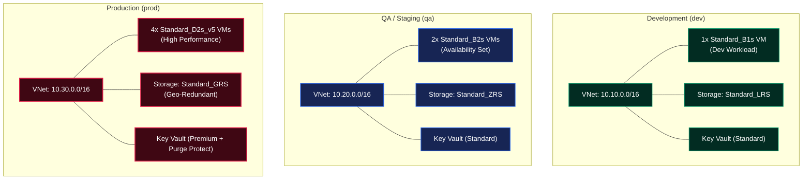

# Multi-Environment Infrastructure Automation on Azure (Dev, QA, Prod)

[](https://www.terraform.io/)
[](https://azure.microsoft.com/)
[](https://dev.azure.com/)
[](https://developer.hashicorp.com/terraform/language/modules)

An enterprise-grade **Multi-Environment Infrastructure Automation** solution provisioning Development, QA, and Production environments on Microsoft Azure from a single reusable Terraform codebase using the DRY (Don't Repeat Yourself) principle, environment variable files, isolated state locking, gated promotion pipelines, and automated drift detection.

---

## 1. Multi-Stage Gated Promotion Workflow

```mermaid
flowchart LR
    subgraph Trigger_Stage["Code Commit"]
        Commit["Git Push to main"]
    end

    subgraph Dev_Stage["Stage 1: Development Environment"]
        Commit --> Dev_Plan["Terraform Plan (dev.tfvars)"]
        Dev_Plan --> Dev_Apply["Auto-Apply to Dev"]
        Dev_Apply --> Dev_Test["Automated Smoke Tests"]
    end

    subgraph QA_Stage["Stage 2: QA / Staging Environment"]
        Dev_Test --> QA_Gate{"QA Approval Gate<br/>(QA Sign-off)"}
        QA_Gate -->|"Approved"| QA_Plan["Terraform Plan (qa.tfvars)"]
        QA_Plan --> QA_Apply["Deploy to QA"]
        QA_Apply --> QA_Integ["Automated Integration Tests"]
    end

    subgraph Prod_Stage["Stage 3: Production Environment"]
        QA_Integ --> Prod_Gate{"Production Approval Gate<br/>(CAB Sign-off)"}
        Prod_Gate -->|"Approved"| Prod_Plan["Terraform Plan (prod.tfvars)"]
        Prod_Plan --> Prod_Apply["Apply to Production (GRS / High Avail)"]
        Prod_Apply --> Prod_Monitor["Continuous Drift Monitoring"]
    end

    classDef triggerStyle fill:#0f172a,stroke:#38bdf8,stroke-width:2px,color:#ffffff;
    classDef devStyle fill:#064e3b,stroke:#34d399,stroke-width:1.5px,color:#ffffff;
    classDef qaStyle fill:#1e1b4b,stroke:#818cf8,stroke-width:1.5px,color:#ffffff;
    classDef prodStyle fill:#4c0519,stroke:#f43f5e,stroke-width:1.5px,color:#ffffff;
    classDef gateStyle fill:#78350f,stroke:#fbbf24,stroke-width:1.5px,color:#ffffff;

    class Commit triggerStyle;
    class Dev_Plan,Dev_Apply,Dev_Test devStyle;
    class QA_Gate,Prod_Gate gateStyle;
    class QA_Plan,QA_Apply,QA_Integ qaStyle;
    class Prod_Plan,Prod_Apply,Prod_Monitor prodStyle;
```



---

## 2. Environment Architecture Topology



---

## 3. Environment Specifications

| Environment | VNet CIDR | VM Count | VM SKU | Storage Tier | Key Vault SKU |
| :--- | :--- | :--- | :--- | :--- | :--- |
| **Development** (`dev`) | `10.10.0.0/16` | 1 | `Standard_B1s` | `Standard_LRS` | `standard` |
| **QA / Staging** (`qa`) | `10.20.0.0/16` | 2 | `Standard_B2s` | `Standard_ZRS` | `standard` |
| **Production** (`prod`) | `10.30.0.0/16` | 4 | `Standard_D2s_v5` | `Standard_GRS` | `premium` |

---

## 4. Repository Structure

```
azure-multi-environment-terraform/
├── architecture/
│   └── architecture.md            # Topology, promotion model and matrix
├── docs/
│   ├── deployment-guide.md        # Step-by-step promotion instructions
│   ├── troubleshooting.md         # State crossover and drift resolution
│   └── interview-questions.md     # Architectural walkthroughs & Q&A
├── pipelines/
│   └── azure-pipelines.yml        # Gated multi-stage promotion pipeline
├── scripts/
│   ├── drift-detection.sh         # CLI automated drift scanner
│   └── validate-all-envs.sh       # Multi-environment validation
└── terraform/
    ├── locals.tf                  # Local values and dynamic naming
    ├── main.tf                    # Root environment composition
    ├── outputs.tf                 # Output declarations
    ├── providers.tf               # Providers and dynamic backend definition
    ├── variables.tf               # Input variable declarations
    ├── environments/
    │   ├── dev/
    │   │   ├── backend-dev.tfvars # Dev remote state config
    │   │   └── dev.tfvars         # Dev parameters
    │   ├── qa/
    │   │   ├── backend-qa.tfvars  # QA remote state config
    │   │   └── qa.tfvars          # QA parameters
    │   └── prod/
    │       ├── backend-prod.tfvars# Prod remote state config
    │       └── prod.tfvars        # Prod parameters
    └── modules/
        └── workload_environment/  # Reusable environment module (VNet, VM, KV, Storage)
```

---

## 5. Quickstart

### Deploy to Development:
```bash
cd terraform
terraform init -reconfigure -backend-config="environments/dev/backend-dev.tfvars"
terraform plan -var-file="environments/dev/dev.tfvars" -out=tfplan-dev
terraform apply tfplan-dev
```

### Run Drift Detection on Production:
```bash
./scripts/drift-detection.sh prod
```

---

## 6. Author

**Firdous Warsi** — *Azure DevOps Engineer*  
- GitHub: [@firdouswarsi](https://github.com/firdouswarsi)
- Specialized in Azure Cloud Architecture, Infrastructure as Code & Multi-Environment Automation.
