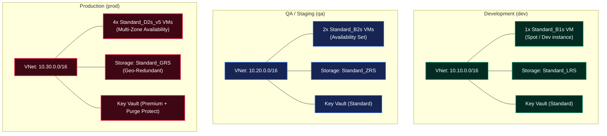

# Multi-Environment Infrastructure Architecture (Dev, QA, Prod)

This document provides the architectural specification for the **Multi-Environment Infrastructure Automation (`azure-multi-environment-terraform`)** codebase, implementing DRY reusable modules, environment state isolation, progressive promotion gates, and drift detection.

---

## 1. Multi-Stage Progressive Promotion Workflow

```mermaid
flowchart LR
    subgraph Trigger_Stage["Code Commit"]
        Commit["Git Push to main"]
    end

    subgraph Dev_Stage["Stage 1: Development Environment"]
        Commit --> Dev_Plan["Terraform Plan (dev.tfvars)"]
        Dev_Plan --> Dev_Apply["Auto-Apply to Dev"]
        Dev_Apply --> Dev_Test["Automated Smoke Tests"]
    end

    subgraph QA_Stage["Stage 2: QA / Staging Environment"]
        Dev_Test --> QA_Gate{"QA Approval Gate<br/>(QA Lead Sign-off)"}
        QA_Gate -->|"Approved"| QA_Plan["Terraform Plan (qa.tfvars)"]
        QA_Plan --> QA_Apply["Deploy to QA"]
        QA_Apply --> QA_Integ["Automated Integration Tests"]
    end

    subgraph Prod_Stage["Stage 3: Production Environment"]
        QA_Integ --> Prod_Gate{"Production Approval Gate<br/>(Change Advisory Board)"}
        Prod_Gate -->|"Approved"| Prod_Plan["Terraform Plan (prod.tfvars)"]
        Prod_Plan --> Prod_Apply["Apply to Production (GRS / High Avail)"]
        Prod_Apply --> Prod_Monitor["Continuous Drift & Health Monitoring"]
    end

    classDef triggerStyle fill:#0f172a,stroke:#38bdf8,stroke-width:2px,color:#ffffff;
    classDef devStyle fill:#064e3b,stroke:#34d399,stroke-width:1.5px,color:#ffffff;
    classDef qaStyle fill:#1e1b4b,stroke:#818cf8,stroke-width:1.5px,color:#ffffff;
    classDef prodStyle fill:#4c0519,stroke:#f43f5e,stroke-width:1.5px,color:#ffffff;
    classDef gateStyle fill:#78350f,stroke:#fbbf24,stroke-width:1.5px,color:#ffffff;

    class Commit triggerStyle;
    class Dev_Plan,Dev_Apply,Dev_Test devStyle;
    class QA_Gate,Prod_Gate gateStyle;
    class QA_Plan,QA_Apply,QA_Integ qaStyle;
    class Prod_Plan,Prod_Apply,Prod_Monitor prodStyle;
```

---

## 2. Environment Infrastructure Topology

Each environment provisions an isolated virtual network, dynamic subnets, tiered NSGs, a VM compute pool, a storage account, and Key Vault. Capacities and SKUs scale dynamically according to environment configurations.

---

## 3. Workspaces vs. Directory-Based State Isolation in Enterprise Azure

| Architectural Parameter | Terraform Workspaces | Directory / Variable-Based Isolation (Selected Architecture) |
| :--- | :--- | :--- |
| **State Storage Location** | Single storage account, single container with directory prefixes | **Independent state files / containers** (`dev.tfstate`, `qa.tfstate`, `prod.tfstate`) |
| **Blast Radius** | High — accidental workspace switch can overwrite prod state | **Strictly Isolated** — credentials and state backends are physically separated |
| **RBAC & Governance** | Difficult to grant dev-only access to developers | **Fine-grained Azure RBAC** scoped per environment subscription / container |
| **CI/CD Pipeline Integration** | Relies on CLI state selection (`terraform workspace select`) | **Explicit, declarative pipeline parameters** targeting specific `.tfvars` |
| **Suitability for Production** | Good for ephemeral testing or multi-tenant single regions | **Enterprise Gold Standard** for mission-critical infrastructure |

---

## 4. Environment Configuration Matrix

| Specification | Development (`dev`) | QA / Staging (`qa`) | Production (`prod`) |
| :--- | :--- | :--- | :--- |
| **VNet CIDR** | `10.10.0.0/16` | `10.20.0.0/16` | `10.30.0.0/16` |
| **Workload Subnet** | `10.10.1.0/24` | `10.20.1.0/24` | `10.30.1.0/24` |
| **Data Subnet** | `10.10.2.0/24` | `10.20.2.0/24` | `10.30.2.0/24` |
| **VM Instance Count** | 1 | 2 | 4 |
| **VM SKU Size** | `Standard_B1s` | `Standard_B2s` | `Standard_D2s_v5` |
| **Storage Redundancy** | `LRS` (Locally Redundant) | `ZRS` (Zone Redundant) | `GRS` (Geo-Redundant) |
| **Key Vault SKU** | `standard` | `standard` | `premium` |
| **Backup Retention** | 7 Days | 14 Days | 30 Days |
